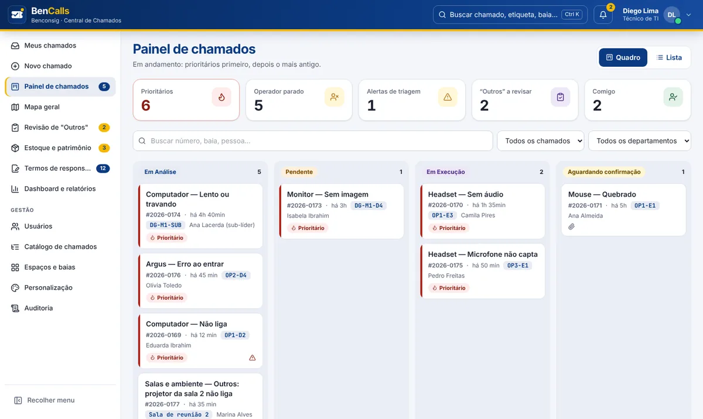
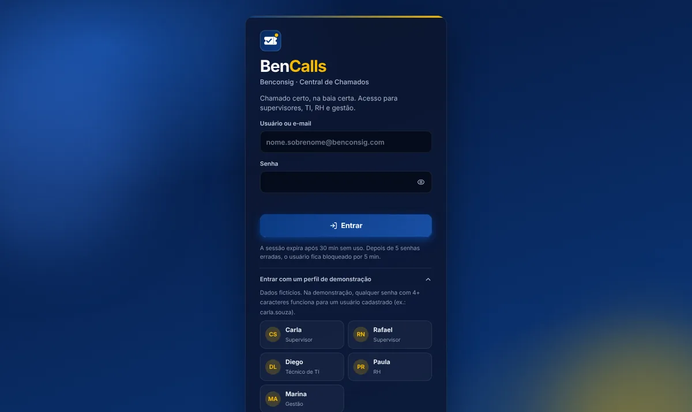
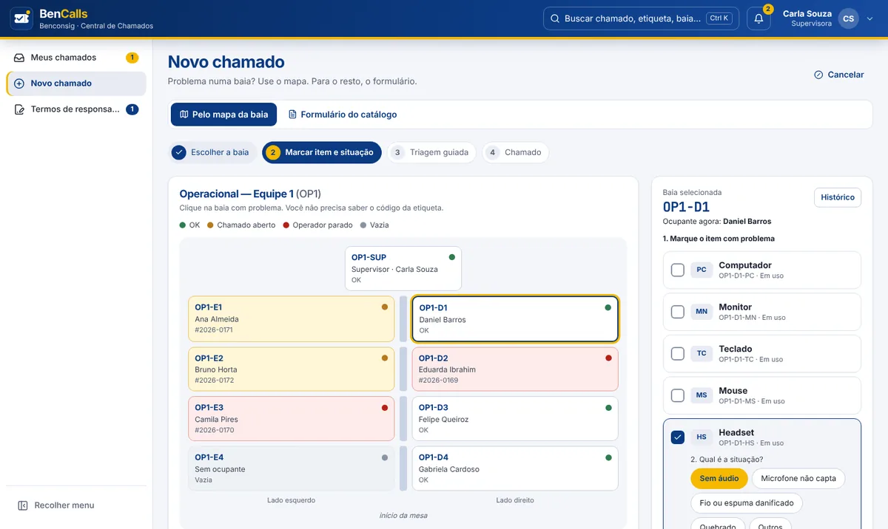
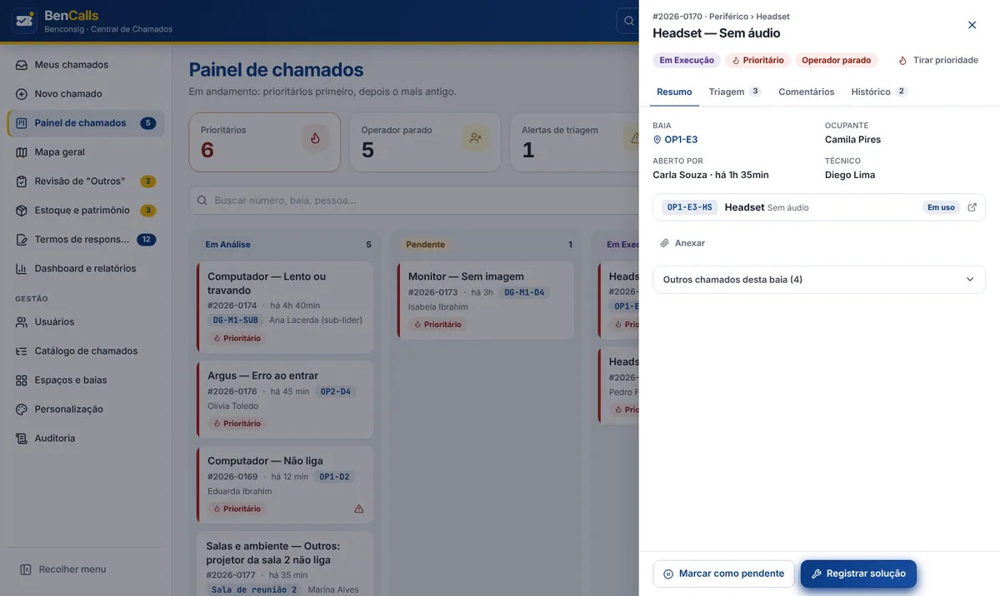
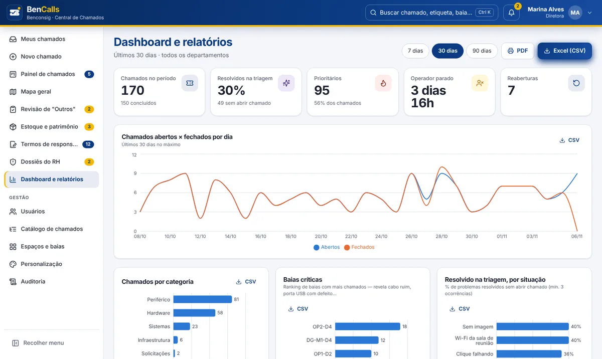

<div align="center">


# BenCalls

**Central de Chamados da Benconsig** · chamado certo, na baia certa.

Chamados vinculados à baia, triagem guiada antes de abrir, estoque com etiqueta e histórico,<br />
termo de responsabilidade, dossiê para o RH e avisos nos grupos do BenHub.


[Rodar no seu PC](#-rodar-no-seu-pc) · [Perfis](#-perfis-de-demonstração) · [Funcionalidades](#-o-que-o-sistema-faz) · [Deploy](#%EF%B8%8F-deploy) · [Segurança](#-segurança)



</div>

> [!NOTE]
> **Modo demonstração.** Enquanto a fase 0 da BenApi (login com token, senhas com hash) não sai, o front roda
> com dados fictícios gerados e salvos no próprio navegador. Cada ação do código indica a rota da BenApi que
> ela vai chamar, para a troca ser direta (veja [Ligando na BenApi](#-ligando-na-benapi)).

---

## 🚀 Rodar no seu PC

**Precisa de:** [Node.js 22.18+](https://nodejs.org) (versão LTS) e [Git](https://git-scm.com).

```bash
git clone https://github.com/nanzinx/BenCalls.git
```

```bash
cd BenCalls
```

```bash
npm install
```

```bash
npm run dev
```

Abra **http://localhost:5173**, clique em **Entrar com um perfil de demonstração** e escolha um perfil.
Para voltar a demonstração ao início: menu do avatar (canto superior direito) › **Reiniciar demonstração**.

<details>
<summary><b>Outras formas de rodar</b> (igual à produção, com pm2 ou Docker)</summary>

<br />

Com **pm2**, como no servidor (abre em http://localhost:8080). Um comando só instala o que faltar, compila,
sobe (ou recarrega) no pm2 e confere se o site respondeu:

```bash
npm run subir
```

Para publicar provisoriamente pelo **ngrok** (o mesmo, mais o túnel, já com o IP real dos visitantes):

```bash
npm run subir:ngrok
```

Acompanhar e parar:

```bash
npm run pm2:logs
```

```bash
npm run pm2:parar
```

Com **Docker** (abre em http://localhost:8080):

```bash
docker compose up -d --build
```

</details>

<details>
<summary><b>Deu erro?</b></summary>

<br />

| Sintoma | O que fazer |
|---|---|
| `npm` não é reconhecido | Feche e abra o terminal de novo depois de instalar o Node. |
| `node -v` mostra versão menor que 22.18 | Instale a versão LTS atual do Node. |
| Porta 5173 ocupada | O Vite usa a próxima porta livre e mostra o endereço no terminal. |
| Dados estranhos depois de atualizar | Menu do avatar › **Reiniciar demonstração**. |
| **403** “Acesso não liberado para este endereço” | Só entram os IPs de [`server/ips-liberados.txt`](server/ips-liberados.txt) e o próprio PC (`localhost`). Para abrir de outro aparelho da rede, some o IP em `IPS_LIBERADOS` no `.env`. No **Docker** do seu PC, o acesso chega pelo IP interno do Docker: coloque `IPS_LIBERADOS=172.16.0.0/12` no `.env`. |

</details>

---

## 👥 Perfis de demonstração

Todos os perfis **abrem e acompanham chamados**. Na demonstração, qualquer senha com 4+ caracteres entra.

| Perfil | Usuário | O que vê |
|---|---|---|
| 🧑‍💼 Supervisora | `carla.souza` | Mapa da Equipe 1, triagem, confirmar solução, termos |
| 🧑‍💼 Supervisor do Digital | `rafael.nunes` | Três mesas, inclusive as sem supervisor |
| 🛠️ Técnico de TI | `diego.lima` | Painel, atendimento com laudo, estoque, mapa geral e **configuração do sistema** (logins, catálogo, espaços, tema, auditoria) |
| 🗂️ RH | `paula.reis` | Dossiês de mau uso, termos e chamados próprios |
| 📊 Gestão | `marina.alves` | Dashboard, relatórios, aprovação de descartes e toda a gestão |

<table>
  <tr>
    <td width="50%"><p align="center"><sub>Tela de acesso</sub></p></td>
    <td width="50%"><p align="center"><sub>Novo chamado pelo mapa da baia</sub></p></td>
  </tr>
  <tr>
    <td width="50%"><p align="center"><sub>Detalhe do chamado</sub></p></td>
    <td width="50%"><p align="center"><sub>Dashboard e relatórios</sub></p></td>
  </tr>
</table>

---

## ✨ O que o sistema faz

| | |
|---|---|
| 🗺️ **Chamado pela baia** | O supervisor clica na baia no mapa da equipe (mesmo layout físico) e marca o item. O código da etiqueta (`OP1-E2-HS`) é gerado pelo sistema. |
| ✅ **Triagem guiada** | Passos obrigatórios antes de abrir, com horário de cada marcação e alerta quando são marcados rápido demais. Resolvido na triagem não vira chamado. |
| 🔥 **Prioridade** | Cada chamado é **prioritário** ou **normal**, sem prazo de conclusão. Nasce prioritário pelo tipo (catálogo) ou com operador parado; o TI pode mudar. A fila mostra prioritários primeiro, depois o mais antigo. |
| 🧾 **Atendimento com laudo** | Solução com a causa do dano e troca do item no mesmo passo (baixa automática no estoque). Laudo “mau uso” gera dossiê para o RH. |
| 📦 **Estoque e patrimônio** | ID interno fixo, etiqueta que acompanha o local, ciclo de vida, descarte com aprovação, mínimos com sugestão de compra, garantias e folha de etiquetas. |
| 📝 **Termos e dossiês** | Aceite digital do operador ao assumir a baia; o RH decide os dossiês (o sistema nunca aplica desconto). |
| 🧭 **Catálogo vivo** | Categoria › tipo › situação com passos de triagem editáveis; “Outros” vira situação oficial na fila de revisão. |
| 🏢 **Multiempresa** | Cores, logo e textos por empresa, com validação de contraste; a assinatura Benconsig é fixa. |
| 👤 **Logins e acessos** | O TI cria logins com senha provisória, redefine senhas e ajusta os acessos de cada pessoa. |
| 🔎 **Busca global** | <kbd>Ctrl</kbd> + <kbd>K</kbd> encontra chamado, etiqueta, ID interno, baia ou tela. |
| 🔔 **Avisos “para você”** | Ao entrar, o site avisa o que chegou para você resolver (encaminhado a você, novo na fila do seu departamento ou que voltou). Contador na aba, sino, alerta na hora (inclusive do navegador) e o TI encaminha para um técnico. |
| 💬 **Controle de WhatsApps** | Integração com o **BenHermes**: situação do WhatsApp de cada baia, celulares, ciclo do banimento, manutenção com o texto do grupo e o mesmo `.json` nos dois sistemas. Chamado “WhatsApp banido” já marca o número; em análise pelo WhatsApp ou restringido, o chamado fica **aguardando o WhatsApp** (sem manutenção) e volta sozinho para o TI ou fecha quando o número voltar. Veja [`docs/BENHERMES.md`](docs/BENHERMES.md). |
| 🔌 **API BenHermes ⇄ BenCalls** | Manutenção feita no BenHermes deixa o WhatsApp OK aqui e **conclui o chamado** da baia na hora; chamados de WhatsApp daqui aparecem lá. Eventos assinados (HMAC), com fila de reenvio. Veja [`docs/API-INTEGRACAO.md`](docs/API-INTEGRACAO.md). |
| 🗂️ **Auditoria** | Central de notificações (cópia do BenHub) e registro imutável de cada ação. |

Detalhes do que mudou em relação ao protótipo: [`docs/MELHORIAS.md`](docs/MELHORIAS.md).

---

## 🧱 Stack

| Camada | Tecnologia |
|---|---|
| Interface | React 18, React Router, Recharts, lucide-react |
| Linguagem | TypeScript estrito nas regras de negócio, logo e entrada; telas em JSX, migrando aos poucos |
| Estilos | Tailwind CSS 3 (mesmo padrão do BenHeimdall) com fonte Inter servida pelo próprio site |
| Build | Vite 5 + PostCSS |
| Produção | Servidor Node sem dependências + pm2 em modo cluster |
| Deploy | Docker endurecido + Cloudflare Tunnel |
| Testes | `node:test` (regras, entrada, servidor, IPs liberados, integração, estilos) |

**Estilos.** [`tailwind.config.ts`](tailwind.config.ts) define as cores como trincas RGB com nomes em português
(`marca`, `destaque`, `superficie`, `tinta`, `mudo`, `ok`, `aviso`, `ruim`…), sombras e animações.
[`src/index.css`](src/index.css) tem os tokens dos temas claro/escuro e os componentes (`.btn`, `.card`, `.kpi`,
`.ticket`, `.seat`…) com `@apply`. O tema de cada empresa sobrescreve as variáveis, então `bg-marca/10`
funciona com qualquer cor. Classes de componente montadas com `${...}` precisam estar no `safelist` (um teste confere).

<details>
<summary><b>Estrutura de pastas</b></summary>

```
src/
  lib/          regras puras em TypeScript: etiquetas e mesas, prioridade, triagem, estoque, contraste, entrada
  data/seed.js  dados de demonstração (69 posições reais, catálogo, estoque, 30 dias de histórico)
  store/        estado + ações (cada ação = uma rota da BenApi) e seletores
  components/   layout, busca global, detalhe de chamado/item/baia, mapa, triagem, logo, entrada, UI
  pages/        uma tela por rota
  index.css     tokens e componentes (Tailwind)
server/         servidor de produção, IPs liberados, API de integração e lock do pm2 da imagem
deploy/         deploy.sh (atualização com rollback automático)
cloudflared/    exemplo de túnel por arquivo
tests/          node:test
docs/           DEPLOY.md, MELHORIAS.md e imagens
```

</details>

<details>
<summary><b>Telas e códigos de acesso</b></summary>

| Tela | Rota | Acesso |
|---|---|---|
| Meus chamados | `/inicio` | DACP |
| Novo chamado (mapa ou formulário) | `/novo` | RC |
| Painel de chamados (quadro e lista) | `/painel` | PC |
| Mapa geral | `/mapa` | MAPA |
| Revisão de “Outros” | `/revisao` | REV |
| Estoque e patrimônio | `/estoque` | EST |
| Termos de responsabilidade | `/termos` | TERMO (módulo) |
| Dossiês do RH | `/rh` | RH (módulo) |
| Dashboard e relatórios | `/relatorios` | DVGC |
| Usuários · Catálogo · Espaços · Personalização · Auditoria | `/usuarios` … | CU · RCSC · ESP · TEMA · AUD |

Detalhes abrem em painel lateral por parâmetro de URL, de qualquer tela: `?ch=171`, `?item=BEN-0412`,
`?baia=OP1:E2` (o link pode ser colado no BenHub).

</details>

---

## 🧪 Verificar

```bash
npm run verificar
```

Roda o typecheck (TypeScript), todos os testes e o build de produção. O mesmo roda no CI e dentro do build do Docker.

---

## ☁️ Deploy

```bash
cp .env.example .env
```

```bash
./deploy/deploy.sh
```

Cole o `TUNNEL_TOKEN` no `.env` antes. O `deploy.sh` faz `git pull`, constrói a imagem (com testes), sobe site e
túnel, espera o healthcheck e volta sozinho para a versão anterior se a nova não subir.
Passo a passo completo, incluindo a configuração na Cloudflare: **[`docs/DEPLOY.md`](docs/DEPLOY.md)**.

---

## 🔒 Segurança

- **Sem porta aberta:** o acesso chega só pelo Cloudflare Tunnel.
- **Container endurecido:** só leitura, sem root, sem capabilities, sem npm na imagem, com limites de memória, CPU e processos.
- **Servidor próprio:** CSP fechado, HSTS e demais cabeçalhos; só serve os arquivos do build; limite de requisições por IP.
- **Só IPs liberados:** como no BenHermes, só entram os IPs e faixas de [`server/ips-liberados.txt`](server/ips-liberados.txt)
  (IPv4 e IPv6, com ou sem `/prefixo`); o resto recebe 403. Vale no servidor, no `npm run dev` e no `npm run preview`.
  Atrás do Cloudflare Tunnel o IP real vem do `CF-Connecting-IP`; atrás do ngrok, ligue `CONFIAR_PROXY=1`
  ([`docs/DEPLOY.md`](docs/DEPLOY.md#9-provisório-publicar-pelo-ngrok)). Para barrar também na borda da Cloudflare, veja
  [`docs/DEPLOY.md`](docs/DEPLOY.md#5-só-ips-liberados).
- **Sessão:** expira após 30 min sem uso; 5 senhas erradas bloqueiam o login por 5 min.

---

## 🔌 Ligando na BenApi

1. **Fase 0** na BenApi (JWT, BCrypt, chave do BenTabularium em variável de ambiente): pré-requisito.
2. Definir `VITE_API_URL` e `API_URL` no `.env` (ver [`.env.example`](.env.example)).
3. Trocar o corpo de cada ação em [`src/store/store.jsx`](src/store/store.jsx) pela chamada HTTP indicada no comentário dela.
   As regras que hoje rodam no navegador (triagem obrigatória, laudo, descarte com aprovação) passam a ser conferidas
   na API; o front continua validando só para dar retorno imediato.

---

<div align="center">
<sub>Desenvolvido por <b>Benconsig</b></sub>
</div>
